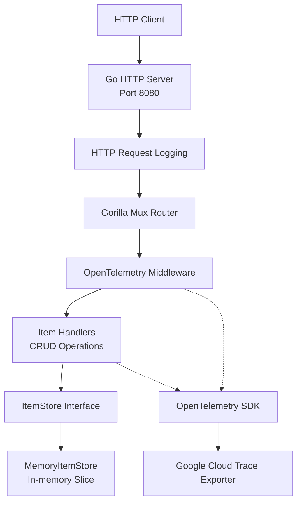

# Acetlisto — Go REST API & DevSecOps

[](https://github.com/KaustubhBuilds/acetlisto/actions/workflows/ci.yml)


**Acetlisto** is a Go-based REST API for managing shopping list items. It was developed collaboratively as part of the DevOps & SecOps course at Hochschule Heilbronn.

The project combines backend API development with software delivery practices, including automated testing, security analysis, containerization, cloud deployment concepts, and application observability.

This repository is my personal portfolio copy. It maintains an independent CI workflow and documents the application, its technical design, verified functionality, and known limitations.

---

## 1. Project Overview

Acetlisto provides a REST interface for creating and managing shopping list items.

Each item contains:

- A unique UUID
- A name
- A description

The application follows a layered structure that separates HTTP routing, request handling, and storage operations.

### Key engineering areas

- REST API development with Go and Gorilla Mux
- Interface-based storage abstraction
- Automated testing and race detection
- Static security analysis and vulnerability checking
- Multi-stage Docker builds
- Non-root container execution
- OpenTelemetry instrumentation
- Optional Google Cloud Trace integration
- GitHub Actions CI automation

---

## 2. Architecture

The application separates its HTTP layer from its storage implementation through the `ItemStore` interface.



### Request flow

1. An HTTP request reaches the Go HTTP server.
2. The request is logged by HTTP logging middleware.
3. Gorilla Mux matches the route and applies OpenTelemetry instrumentation.
4. The corresponding handler processes the request.
5. The handler interacts with the storage layer through `ItemStore`.
6. The API returns a JSON response with an appropriate HTTP status code.

### Application structure

| Directory / File | Responsibility |
|---|---|
| `cmd/main.go` | Application entry point, configuration, and HTTP server |
| `cmd/otel.go` | OpenTelemetry SDK and Google Cloud Trace exporter |
| `handlers/base.go` | Router setup and shared HTTP response helpers |
| `handlers/items.go` | Shopping item REST handlers |
| `stores/base.go` | Item models and storage interface |
| `stores/memory.go` | In-memory storage implementation |
| `handlers/*_test.go` | HTTP handler tests |
| `stores/*_test.go` | Storage unit tests |
| `.github/workflows/ci.yml` | Independent GitHub Actions CI workflow |
| `Dockerfile` | Multi-stage container build |

---

## 3. REST API

The API exposes the following endpoints:

| Method | Endpoint | Description | Success |
|---|---|---|---|
| GET | `/` | Redirect to `/items/` | 307 |
| GET | `/items/` | Retrieve all items | 200 |
| POST | `/items/` | Create an item | 201 |
| GET | `/items/{ID}` | Retrieve an item | 200 |
| PUT | `/items/{ID}` | Update an item | 200 |
| DELETE | `/items/{ID}` | Delete an item | 200 |

### Example requests

**Create an item**

```bash
curl -i -X POST http://localhost:8080/items/ \
  -H "Content-Type: application/json" \
  -d '{
    "name": "Olive Oil",
    "description": "Shopping list item"
  }'
```

**List all items**

```bash
curl -i http://localhost:8080/items/
```

**Retrieve one item**

```bash
curl -i http://localhost:8080/items/ITEM_ID
```

**Update an item**

```bash
curl -i -X PUT http://localhost:8080/items/ITEM_ID \
  -H "Content-Type: application/json" \
  -d '{
    "name": "Extra Virgin Olive Oil",
    "description": "Updated shopping list item"
  }'
```

**Delete an item**

```bash
curl -i -X DELETE http://localhost:8080/items/ITEM_ID
```

Replace `ITEM_ID` with the UUID returned when creating an item.

### Error handling

The current implementation returns:

- `400 Bad Request` for invalid JSON payloads.
- `404 Not Found` for missing items in GET and PUT operations.
- `500 Internal Server Error` when deleting a nonexistent item (current implementation behavior).
- `500 Internal Server Error` for selected storage failures.

Error responses use a JSON object containing an `error` field.

---

## 4. Technology Stack

| Area | Technologies |
|---|---|
| Programming language | Go |
| HTTP routing | Gorilla Mux |
| Configuration | Viper |
| Data model | UUID-based shopping list items |
| Storage | In-memory implementation behind an interface |
| Testing | Go testing, Testify |
| Code analysis | Go vet |
| Security scanning | GoSec |
| Vulnerability analysis | Govulncheck |
| CI/CD | GitHub Actions |
| Containerization | Docker |
| Observability | OpenTelemetry |
| Cloud tracing | Google Cloud Trace exporter |

The broader university team project also explored Snyk, Google Cloud Run, Google Artifact Registry, and Workload Identity Federation. These should be understood as team-project technologies, not as active integrations in this personal repository's CI workflow.

---

## 5. DevSecOps Pipeline

The personal repository includes an independent GitHub Actions workflow.

**Workflow:** `.github/workflows/ci.yml`

It runs on:

- Pushes to `main`
- Pull requests targeting `main`

### Pipeline stages

| Stage | Tool / Command | Purpose |
|---|---|---|
| Checkout | GitHub Actions | Retrieve repository source |
| Go setup | setup-go | Configure Go 1.27 |
| Dependencies | `go mod download` | Download Go modules |
| Formatting | `gofmt` | Enforce Go formatting |
| Static analysis | `go vet ./...` | Detect suspicious code |
| Automated tests | `go test -race` | Execute tests with race detection and coverage |
| Security analysis | GoSec | Identify potential Go security issues |
| Vulnerability checking | Govulncheck | Check dependencies and reachable vulnerabilities |
| Container build | `docker build` | Validate the Docker image build |

### CI configuration

The workflow uses:

- Read-only repository contents permission.
- Go module caching.
- A pinned GoSec version.
- The Govulncheck GitHub Action.
- A Docker image build as its final stage.

**Scope:** This personal workflow validates source code, tests, security checks, and container buildability. It does not publish images or deploy to Google Cloud.

### CI result

The initial GitHub Actions run completed successfully on the `main` branch.

The workflow provides repeatable validation whenever changes are pushed or proposed through a pull request.

---

## 6. Containerization and Security

Acetlisto uses a multi-stage Docker build to separate compilation from runtime execution.

### Build stage

- Uses the Go 1.27 Trixie image.
- Downloads Go module dependencies.
- Compiles a static Linux binary with CGO disabled.

### Runtime stage

- Uses `gcr.io/distroless/static-debian13:nonroot`.
- Copies only the compiled application binary.
- Runs as `nonroot:nonroot`.
- Exposes port `8080`.

### Security-related design choices

| Control | Implementation |
|---|---|
| Multi-stage build | Build tooling excluded from runtime image |
| Minimal runtime | Distroless Debian 13 |
| Non-root execution | `USER nonroot:nonroot` |
| Static binary | `CGO_ENABLED=0` |
| Dependency analysis | Govulncheck |
| Static security analysis | GoSec |

These controls reduce the runtime image's attack surface. They do not replace runtime security controls such as authentication, authorization, network restrictions, or production monitoring.

### Build and run

Build the image:

```bash
docker build -t acetlisto:local .
```

Run the container:

```bash
docker run --rm -p 8080:8080 acetlisto:local
```

Test the API:

```bash
curl -i http://localhost:8080/items/
```

---

## 7. Testing and Verification

The project contains unit tests for the HTTP handlers and storage implementation.

### Test coverage areas

**HTTP handlers**

- Listing items
- Creating items
- Retrieving items
- Updating items
- Deleting items
- Handling nonexistent items
- Invalid request payloads
- Selected storage error scenarios

**Storage**

- Initial empty state
- UUID generation
- Item creation and retrieval
- Updating existing items
- Handling nonexistent IDs
- Item deletion

### Local validation

The following checks were successfully executed during portfolio preparation:

| Check | Result |
|---|---|
| Go formatting (`gofmt`) | Passed |
| Go vet | Passed |
| Go tests with race detection | Passed |
| GoSec | Passed — 0 reported issues |
| Govulncheck | Passed — no vulnerabilities reported |
| Docker image build | Passed |
| Docker runtime startup | Passed |
| Docker CRUD verification | Passed |

### Container runtime verification

The updated Debian 13 Distroless image was tested by running the actual container and sending HTTP requests.

| Test | Observed result |
|---|---|
| List items | `200 OK` |
| Create item | `201 Created` |
| Retrieve item | `200 OK` |
| Update item | `200 OK` |
| Delete item | `200 OK` |
| Retrieve deleted item | `404 Not Found` |

This verifies that the application builds, starts, and performs its CRUD operations inside the updated container image.

---

## 8. Observability

Acetlisto integrates OpenTelemetry instrumentation at both the HTTP router and handler levels.

### Instrumentation

- Gorilla Mux OpenTelemetry middleware instruments incoming requests.
- Handler-level spans are created for list, create, retrieve, update, and delete operations.
- The tracing SDK uses a batch span processor.
- The Google Cloud Trace exporter is available as an optional integration.

### Configuration

Cloud tracing is disabled by default.

Enable it with:

```bash
export ENABLE_CLOUD_TRACE=true
go run ./cmd
```

Enabling cloud tracing requires Google Cloud Application Default Credentials and a configured Google Cloud project. Without these prerequisites, tracing initialization fails.

To run locally without Google Cloud credentials, leave `ENABLE_CLOUD_TRACE` unset:

```bash
unset ENABLE_CLOUD_TRACE
go run ./cmd
```

**Important:** The presence of tracing integration does not mean this personal repository currently operates a live Google Cloud deployment.

---

## 9. Engineering Decisions and Trade-offs

### Storage abstraction

The `ItemStore` interface separates storage operations from HTTP request handling.

This makes the handlers independent of the concrete storage implementation and provides a foundation for introducing another storage backend.

### In-memory storage

The current implementation uses a Go slice to store items.

**Advantages:**

- Simple implementation.
- No external database dependency.
- Easy local development and testing.

**Limitations:**

- Data is lost when the application restarts.
- Item lookup uses a linear search.
- The store does not currently synchronize concurrent access.

### Optional cloud tracing

Cloud tracing is disabled by default to keep local development independent of Google Cloud credentials.

It can be enabled explicitly in environments where the required cloud configuration is available.

### Minimal runtime container

The application is compiled in a separate build stage and runs in a Distroless runtime image as a non-root user.

This reduces unnecessary runtime components and limits the privileges of the application process.

---

## 10. Known Limitations and Future Improvements

The current implementation is intentionally simple and provides a foundation for further engineering work.

| Area | Current limitation | Possible improvement |
|---|---|---|
| Persistence | In-memory storage only | Integrate PostgreSQL or another persistent database |
| Concurrency | No synchronization in memory store | Add mutex protection and concurrent-access tests |
| Performance | Linear item lookup | Consider map-based storage or database indexing |
| Input validation | Limited JSON decoding checks | Add validation for required fields and payload size |
| Error handling | Some storage errors are generic | Introduce typed errors and consistent error responses |
| API security | No authentication or authorization | Add an appropriate identity and access-control layer |
| API documentation | No formal API specification | Add an OpenAPI specification |
| Observability | Optional trace exporter | Add metrics, structured logging, and production monitoring |

These are known areas for improvement rather than features that the current implementation claims to provide.

---

## 11. Personal Portfolio Scope and Team Context

Acetlisto originated as a collaborative university project at Hochschule Heilbronn.

The original team project covered application development, testing, DevSecOps workflows, containerization, cloud deployment concepts, and observability.

This personal repository is maintained separately to demonstrate the project and provide an independently reproducible development and CI environment.

My portfolio work includes:

- Maintaining the personal GitHub repository and its Go module configuration.
- Maintaining an independent GitHub Actions validation workflow.
- Configuring optional Google Cloud Trace initialization for local execution.
- Updating and validating the multi-stage Distroless Docker image.
- Running local quality, security, and vulnerability checks.
- Verifying the complete CRUD lifecycle inside the updated Docker container.
- Documenting architecture, implementation decisions, and technical limitations.

The original application was developed collaboratively. The points above describe my portfolio maintenance and verification work, not sole authorship of the university team's implementation.

---

## 12. Running the Project Locally

### Prerequisites

- Go 1.27 or compatible toolchain
- Git
- Docker (optional)

### Clone

```bash
git clone https://github.com/KaustubhBuilds/acetlisto.git
cd acetlisto
```

### Run with Go

```bash
go mod download
go run ./cmd
```

The API listens on port `8080` by default.

### Run with Docker

```bash
docker build -t acetlisto:local .
docker run --rm -p 8080:8080 acetlisto:local
```

### Run tests

```bash
go test -race -coverprofile=coverage.out ./...
```

### Run static analysis

```bash
go vet ./...
```

### Run GoSec

```bash
go run github.com/securego/gosec/v2/cmd/gosec@v2.30.0 ./...
```

### Run Govulncheck

```bash
go run golang.org/x/vuln/cmd/govulncheck@latest ./...
```

---

## 13. Project Context

**Course:** DevOps & SecOps

**Institution:** Hochschule Heilbronn

**Project:** Acetlisto — Shopping List REST API

**Repository:** [KaustubhBuilds/acetlisto](https://github.com/KaustubhBuilds/acetlisto)

The project provided practical experience with Go backend development, automated software quality checks, container security, vulnerability analysis, and observability.
